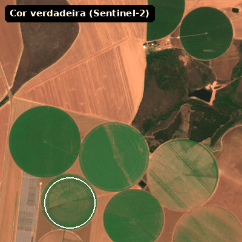
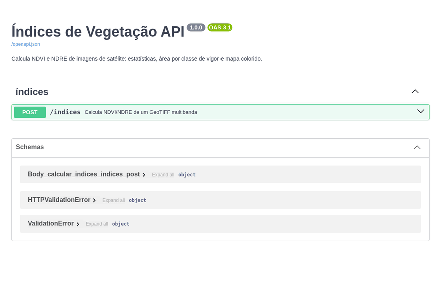
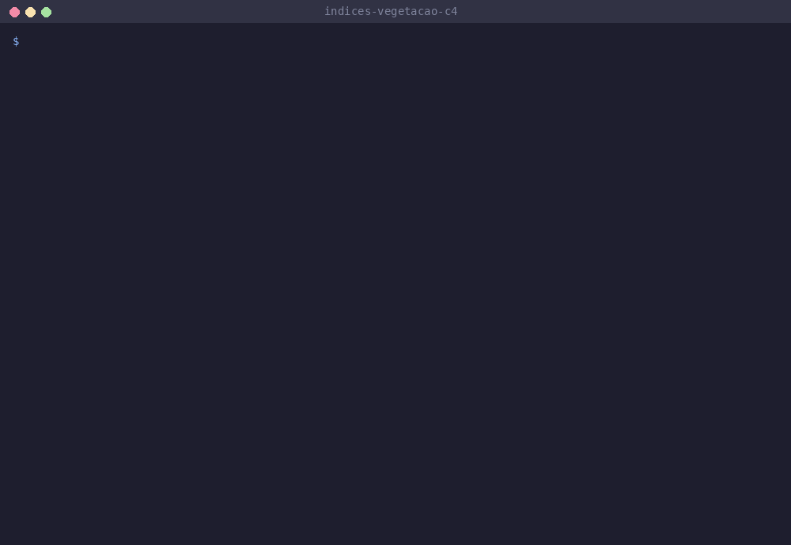
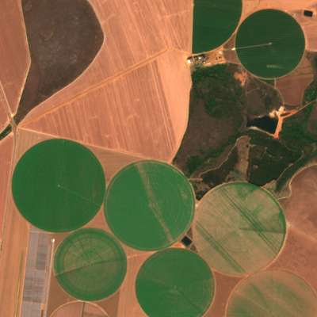
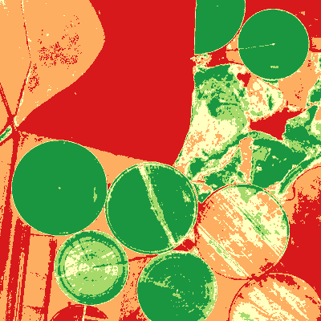
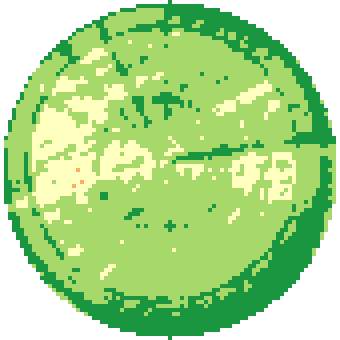

# Índices de Vegetação API (NDVI/NDRE)

API REST em Python que recebe uma imagem de satélite multibanda (GeoTIFF) e devolve os índices de
vegetação **NDVI** e **NDRE** de um talhão: estatísticas (mínimo, máximo, média, desvio padrão,
quartis), **área em hectares por classe de vigor** e um **mapa colorido em PNG**. O recorte do
talhão é opcional e aceita o polígono em GeoJSON (lat/lon), do jeito que se exporta do QGIS ou do
geojson.io.

<p align="center">
  
  <br>
  <sub>Pivôs centrais em Cristalina (GO), Sentinel-2 de 31/08/2026: cor verdadeira e o NDVI calculado pela API. O círculo branco é o talhão de exemplo.</sub>
</p>

Mini-projeto do Curso 4 (Laboratório Introdutório: Construindo um Mini-projeto com IA Generativa)
da Especialização em Engenharia de Software com IA Generativa (UFG/AKCIT).

## Demonstração

### No navegador, pela documentação interativa

Com a API rodando (`make run`), a página `/docs` permite testar tudo sem escrever código: enviar o
GeoTIFF, informar as bandas, colar o GeoJSON do talhão e executar. O GIF termina com o PNG que
veio na resposta, decodificado.



### No terminal

`make test` com os 20 testes, e depois uma chamada com `curl`, usando o `jq` para esconder o PNG em
base64 e mostrar só as estatísticas do NDVI:



### Resultado

| Cor verdadeira | NDVI da janela (4 x 4 km) | NDVI do talhão recortado |
| --- | --- | --- |
|  |  |  |

Classes de vigor (vermelho = muito baixo, verde escuro = muito alto):

| Classe | NDVI | NDRE |
| --- | --- | --- |
| muito_baixo | < 0,25 | < 0,10 |
| baixo | 0,25 a 0,40 | 0,10 a 0,20 |
| medio | 0,40 a 0,55 | 0,20 a 0,30 |
| alto | 0,55 a 0,70 | 0,30 a 0,40 |
| muito_alto | ≥ 0,70 | ≥ 0,40 |

O valor exatamente no limite pertence à classe de cima.

## Tecnologias utilizadas

- Python 3.10+
- FastAPI (API e documentação interativa em `/docs`) e Uvicorn
- rasterio (leitura de GeoTIFF, recorte por polígono, reprojeção da geometria), numpy e Pillow
- pytest para os testes
- Claude Code (Anthropic, modelo Claude Opus 5.5) como par de programação: planejamento, código,
  testes, dados de exemplo e este README, sob orientação e revisão do autor

## Pré-requisitos

- Python 3.10 ou superior
- `make` (opcional, os comandos equivalentes estão no `Makefile`)

As wheels do rasterio já trazem o GDAL, então não é preciso instalar nada do sistema.

## Instalação

```bash
git clone https://github.com/vinicioslimer/indices-vegetacao-c4.git
cd indices-vegetacao-c4
make install
```

## Uso

```bash
make run   # sobe em http://localhost:8000 (documentação interativa em /docs)
```

`POST /indices` recebe `multipart/form-data`:

| Campo | Obrigatório | Descrição |
| --- | --- | --- |
| `file` | sim | GeoTIFF multibanda em CRS projetado (metros), ex.: UTM |
| `red` | sim | número da banda do vermelho (começa em 1) |
| `nir` | sim | número da banda do infravermelho próximo |
| `rededge` | não | número da banda red edge; se enviado, calcula também o NDRE |
| `geometry` | não | GeoJSON do talhão em EPSG:4326 (Polygon, Feature ou FeatureCollection) |

Com os arquivos de exemplo do repositório (bandas 1 = B04 vermelho, 2 = B05 red edge, 3 = B08 NIR):

```bash
curl -F file=@exemplos/talhao.tif -F red=1 -F rededge=2 -F nir=3 \
     -F "geometry=<exemplos/talhao.geojson" \
     http://localhost:8000/indices
```

Repare no `<` em `geometry`: ele envia o **conteúdo** do arquivo como texto. Com `@` o curl
enviaria o GeoJSON como arquivo e a API responderia 422.

Para ler só as estatísticas, sem o PNG em base64 (requer [jq](https://jqlang.org/)), acrescente
`| jq '.ndvi | del(.png)'` ao comando.

Resposta (PNG encurtado):

```json
{
  "ndvi": {
    "min": 0.3828, "max": 0.8105, "mean": 0.6359, "std": 0.0781,
    "q1": 0.5818, "median": 0.6342, "q3": 0.6964, "pixels": 5515,
    "classes_ha": {"muito_baixo": 0.0, "baixo": 0.03, "medio": 7.53, "alto": 34.51, "muito_alto": 13.08},
    "png": "iVBORw0KGgoAAAANSUhEUgAA..."
  },
  "ndre": {
    "min": 0.243, "max": 0.5382, "mean": 0.4007, "std": 0.0538,
    "q1": 0.3628, "median": 0.3977, "q3": 0.4402, "pixels": 5515,
    "classes_ha": {"muito_baixo": 0.0, "baixo": 0.0, "medio": 1.59, "alto": 27.04, "muito_alto": 26.52},
    "png": "iVBORw0KGgoAAAANSUhEUgAA..."
  }
}
```

O pivô de exemplo tem raio de 420 m (55,42 ha teóricos). A API mede 55,15 ha, e a diferença é a
borda do círculo discretizada em pixels de 10 m.

Numeração de bandas em sensores comuns:

| Sensor | `red` | `rededge` | `nir` |
| --- | --- | --- | --- |
| Arquivo de exemplo (Sentinel-2 B04/B05/B08) | 1 | 2 | 3 |
| PlanetScope 8 bandas (`ortho_analytic_8b_sr`) | 6 | 7 | 8 |

Erros de entrada respondem 422 com a mensagem em português: arquivo que não é raster, banda
inexistente, raster em CRS geográfico (graus não dão área em hectares), GeoJSON inválido,
polígono fora da imagem ou área sem nenhum pixel válido. Arquivos acima de 50 MB respondem 413.

## Testes

```bash
make test
```

20 testes, todos com dados sintéticos de valor conhecido e sem rede:

- **núcleo** (`tests/test_indices.py`): NDVI com valores exatos, sem estouro de inteiro em bandas
  `uint16`, máscara de divisão por zero e de pixels já mascarados, estatísticas ignorando pixels
  mascarados, áreas por classe incluindo os valores exatamente no limite, PNG com transparência.
- **API** (`tests/test_api.py`): gera um GeoTIFF 10 x 10 em UTM com NDVI 0,8 na metade esquerda e
  0,2 na direita e confere média, áreas em hectares, NDRE, recorte por polígono em lat/lon (nos
  três formatos de GeoJSON) e cada caso de erro 422.

## Arquitetura

```
vegetacao/indices.py   núcleo puro (numpy): índice, estatísticas, classes, PNG. Sem I/O.
vegetacao/main.py      API: upload, validação, leitura/recorte com rasterio, resposta.
```

O núcleo não conhece HTTP nem arquivos, então é testado só com arrays. A API só cuida da
fronteira: validar a entrada, ler o raster e montar a resposta.

## Como a IA acelerou este projeto

O projeto foi feito numa única sessão com o Claude Code, do planejamento ao README.

**Planejamento.** A IA leu as anotações do curso (critérios de MVP da U2, checklist da U5) e os
meus repositórios locais. No meu trabalho com agricultura de precisão já existe um serviço interno
que calcula NDVI/NDRE de imagens licenciadas. A proposta foi uma versão pequena, independente e
testada da mesma ideia, com dados abertos do Sentinel-2, sem código nem dados de clientes.

**Decisões de arquitetura influenciadas pela IA:**

- separar o núcleo numpy (`indices.py`) da API (`main.py`), para testar o cálculo sem subir
  servidor nem gerar arquivo;
- classificar com `np.digitize` (vetorizado) em vez de laço pixel a pixel;
- calcular a área do pixel pela geotransformação do raster em vez de um valor fixo, porque
  funciona igual para Sentinel-2 (100 m²) e PlanetScope (9 m²);
- converter para float antes de somar as bandas, porque somar dois `uint16` grandes estoura;
- reprojetar o polígono de lat/lon para o CRS do raster com `rasterio.warp.transform_geom`,
  porque o usuário desenha em lat/lon e a imagem está em UTM.

**TDD.** Os testes do núcleo foram escritos e commitados antes da implementação (commits
`test(indices)` e depois `feat(indices)` no histórico).

**Onde a revisão foi indispensável:**

- **Offset radiométrico do Sentinel-2.** O metadado do catálogo STAC indicava `offset: -0.1`, ou
  seja, subtrair 1000 dos valores. A primeira versão do arquivo de exemplo fez isso. Conferindo a
  distribuição dos dados, 46% dos pixels da banda vermelha ficavam com reflectância negativa, o
  que é fisicamente impossível. As COGs dessa fonte já vêm harmonizadas, e o exemplo foi gerado
  de novo com os valores originais. Seguir o metadado sem olhar o dado teria gerado um NDVI
  errado, e nenhum teste unitário pegaria isso.
- **Tratamento de erro.** A primeira versão envolvia todo o processamento num `try` que
  transformaria qualquer `ValueError` inesperado em "arquivo não é um raster válido". Na revisão,
  o `try` passou a cobrir só a abertura do arquivo.
- **Uso real.** Só a demonstração de ponta a ponta com `curl` mostrou que `-F geometry=@arquivo`
  envia o GeoJSON como arquivo, e não como texto. Por isso o README ensina o `<`.
- **Os testes pegam erro de verdade?** Foram injetados três defeitos de propósito: bandas
  vermelho/NIR invertidas, área fixa de 9 m² e soma no tipo inteiro. Cada um fez testes falharem
  (4, 4 e 2 falhas) antes de ser revertido.
- **Avisos de depreciação.** Antes de silenciar os avisos no `pytest.ini`, foi confirmado que
  vinham de dentro do rasterio/affine, e não do código do projeto.

**Documentação visual.** Os GIFs também foram produzidos com a IA: ela dirigiu o navegador com
Playwright pelo Swagger e montou os quadros com o Pillow. Olhar os quadros gravados mostrou dois
acabamentos que faltavam e que passaram despercebidos nos testes: o Swagger exibia o grupo
genérico "default" e o resumo "Calcular Indices" (a API ganhou título, descrição e tag), e os
testes parametrizados apareciam como `<lambda>0`, `<lambda>1` (ganharam nomes legíveis).

## Limitações e próximos passos

- **Sem máscara de nuvem e sombra.** Pixels de nuvem entram nas estatísticas. O próximo passo
  natural é usar a banda SCL do Sentinel-2 (ou a UDM2 da Planet) para mascarar pixel a pixel.
- **Limites de classe fixos**, os mesmos para qualquer cultura e estágio. Quebras por quantil ou
  Jenks deixariam o mapa relativo ao próprio talhão.
- **As bandas precisam chegar em reflectância, sem offset.** Fontes Sentinel-2 não harmonizadas
  (processing baseline 04.00 ou mais) exigem subtrair 1000 antes do envio.
- **Sem filtro de outliers** nas estatísticas.
- **A resposta traz só o PNG**, sem o GeoTIFF do índice (que seria útil para abrir no QGIS).
- **O processamento é todo em memória**, com limite de 50 MB por upload.
- **Ideias:** receber só o polígono e a data e buscar a cena direto no STAC público do
  Sentinel-2; série temporal de NDVI por talhão; Dockerfile.

## Dados de exemplo e créditos

`exemplos/talhao.tif` é um recorte de 400 x 400 pixels (10 m, EPSG:32723) das bandas B04, B05
(reamostrada de 20 m para 10 m) e B08 da cena Sentinel-2 L2A `S2B_23LKC_20260831_0_L2A`, obtida
no catálogo público Earth Search (Element84). Os valores são reflectância de superfície x 10000.
`exemplos/talhao.geojson` é o contorno aproximado de um dos pivôs da imagem.

Os GIFs em `docs/` mostram a API rodando localmente com esses arquivos. O do Swagger é uma
sequência de capturas do navegador (Playwright + Chrome). O do terminal é renderizado a partir das
saídas reais de `make test` e do `curl`.

Contains modified Copernicus Sentinel data 2026.

## Licença

MIT. Ver [LICENSE](LICENSE).
